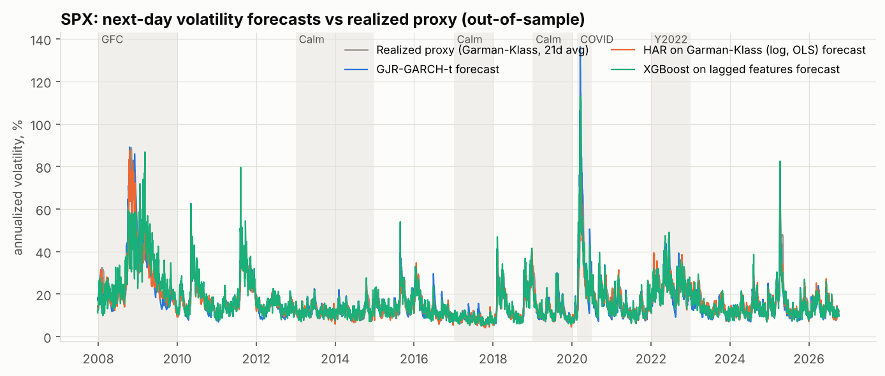
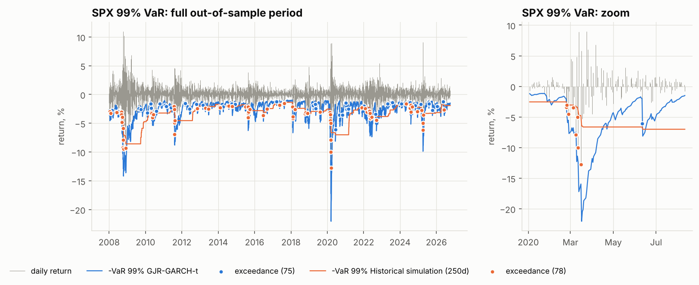
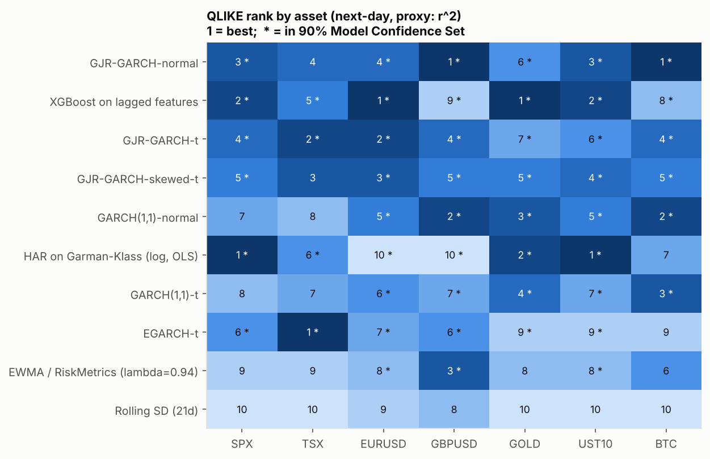
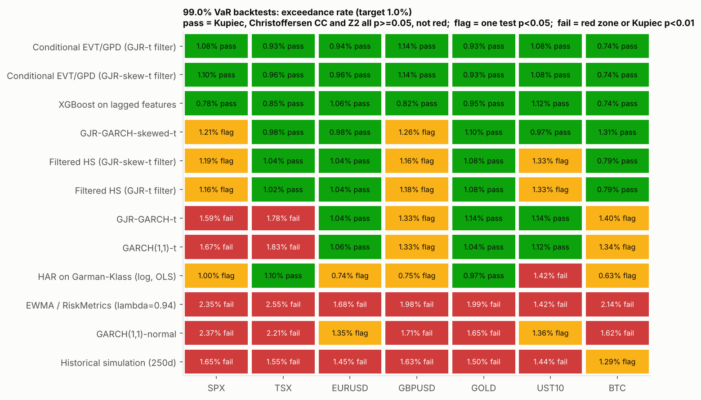

# Forecasting volatility and tail risk: how well do the models actually hold up?


**Summary.** I backtest 13 volatility and Value-at-Risk models (EWMA, historical
simulation, the GARCH family, HAR, XGBoost, filtered HS and Extreme Value Theory) on
seven public instruments from 2005 onward: S&P 500, TSX, EUR/USD, GBP/USD, gold, long
Treasuries and Bitcoin. Every forecast uses only data available at the previous
close, and a perturbation test checks this. Models are judged the way a bank's
model-validation team would judge them: QLIKE with Diebold-Mariano tests and a Model
Confidence Set for volatility; Kupiec, Christoffersen, Basel traffic lights, an
Expected Shortfall test and the FZ0 loss for 99% / 97.5% VaR and ES; overall and in
2008, COVID and 2022. The first run showed symmetric fat-tailed GARCH failing at 99% on
equity indices, so I wrote down a hypothesis (*negative skewness is the cause*) and a
decision rule **before** testing it. All numbers below are generated by the pipeline.
Write-up: [model validation report](docs/MODEL_VALIDATION_REPORT.md).

## Research question: does modelling skewness fix the equity VaR failures?

<!-- AUTO:research -->
**Question.** GJR-GARCH-t forecast equity volatility well but breached its 99% VaR too often (red zone for the S&P 500 and TSX in the first run), while filtered HS with the same volatility did not. Is the failure caused by ignoring negative skewness? The hypothesis and the decision rule were written down before the skewed-t model was run (METHODOLOGY section 9, `src/voltail/reporting/research.py`).

**Verdict (mechanical, pre-registered rule): SUPPORTED.**

- SPX: C1 met (lambda = -0.163, t = -9.1); C2 met (99% exceedances 1.59% -> 1.21%, zone red -> green, Kupiec p 0.166); C3 met (FZ0 difference -0.0451, one-sided DM p 0.005).
- TSX: C1 met (lambda = -0.242, t = -12.5); C2 met (99% exceedances 1.78% -> 0.98%, zone red -> green, Kupiec p 0.870); C3 met (FZ0 difference -0.0425, one-sided DM p 0.022).

Estimated skewness (lambda < 0 = heavier left tail):

| asset   |   lambda_full_sample |    se |   t_stat |   lambda_refit_min |   lambda_refit_median |   lambda_refit_max |
|:--------|---------------------:|------:|---------:|-------------------:|----------------------:|-------------------:|
| SPX     |               -0.163 | 0.018 |   -9.111 |             -0.178 |                -0.159 |             -0.139 |
| TSX     |               -0.242 | 0.019 |  -12.474 |             -0.330 |                -0.245 |             -0.234 |
| EURUSD  |               -0.006 | 0.018 |   -0.309 |             -0.044 |                -0.020 |              0.061 |
| GBPUSD  |               -0.026 | 0.018 |   -1.436 |             -0.036 |                -0.022 |              0.062 |
| GOLD    |               -0.064 | 0.018 |   -3.596 |             -0.107 |                -0.070 |             -0.052 |
| UST10   |               -0.058 | 0.021 |   -2.821 |             -0.077 |                -0.059 |              0.001 |
| BTC     |               -0.001 | 0.017 |   -0.046 |             -0.059 |                -0.022 |              0.013 |

GJR-GARCH-t vs GJR-GARCH-skewed-t, every asset and level:

| asset   | level   |    n | exceed t   |   Kupiec p (t) | zone t   | exceed skew-t   |   Kupiec p (skew-t) | zone skew-t   |   FZ0 skew-t minus t |   DM p (skew-t better) |
|:--------|:--------|-----:|:-----------|---------------:|:---------|:----------------|--------------------:|:--------------|---------------------:|-----------------------:|
| SPX     | 99.0%   | 4723 | 1.59%      |          0.000 | red      | 1.21%           |               0.166 | green         |               -0.045 |                  0.005 |
| SPX     | 97.5%   | 4723 | 3.66%      |          0.000 | red      | 2.75%           |               0.274 | green         |               -0.034 |                  0.001 |
| TSX     | 99.0%   | 4711 | 1.78%      |          0.000 | red      | 0.98%           |               0.870 | green         |               -0.042 |                  0.022 |
| TSX     | 97.5%   | 4711 | 3.74%      |          0.000 | red      | 2.48%           |               0.942 | green         |               -0.030 |                  0.010 |
| EURUSD  | 99.0%   | 4888 | 1.04%      |          0.762 | green    | 0.98%           |               0.899 | green         |                0.002 |                  0.744 |
| EURUSD  | 97.5%   | 4888 | 2.41%      |          0.699 | green    | 2.43%           |               0.768 | green         |                0.001 |                  0.830 |
| GBPUSD  | 99.0%   | 4905 | 1.33%      |          0.029 | yellow   | 1.26%           |               0.074 | yellow        |                0.003 |                  0.831 |
| GBPUSD  | 97.5%   | 4905 | 3.20%      |          0.003 | yellow   | 3.12%           |               0.007 | yellow        |                0.000 |                  0.589 |
| GOLD    | 99.0%   | 4723 | 1.14%      |          0.333 | green    | 1.10%           |               0.492 | green         |               -0.010 |                  0.164 |
| GOLD    | 97.5%   | 4723 | 2.90%      |          0.085 | yellow   | 2.52%           |               0.931 | green         |               -0.008 |                  0.108 |
| UST10   | 99.0%   | 4723 | 1.14%      |          0.333 | green    | 0.97%           |               0.857 | green         |               -0.003 |                  0.287 |
| UST10   | 97.5%   | 4723 | 2.99%      |          0.038 | yellow   | 2.71%           |               0.361 | green         |               -0.004 |                  0.097 |
| BTC     | 99.0%   | 3652 | 1.40%      |          0.023 | yellow   | 1.31%           |               0.069 | yellow        |               -0.014 |                  0.031 |
| BTC     | 97.5%   | 3652 | 3.50%      |          0.000 | red      | 3.45%           |               0.000 | yellow        |               -0.011 |                  0.008 |

**Placebo check (automatic).** On the synthetic data (symmetric-t innovations, so H1 is false by construction) the same rule returns **NOT SUPPORTED**.
<!-- /AUTO:research -->

### Follow-up: does the skewed-t filter also improve filtered HS and EVT?

<!-- AUTO:research_h2 -->
**Question.** Does filtering the semi-parametric tail models (filtered HS, conditional EVT) with the skewed-t GJR model instead of the symmetric-t one improve them? Pre-registered in METHODOLOGY section 10, with the stated prior that it would change little (these models already take the tail shape from the data).

**Verdict (mechanical, pre-registered rule): PARTIALLY SUPPORTED.**

- fhs_gjr -> fhs_skewt: E1 NOT met (cells passing all tests 8 -> 8 of 14); E2 met (FZ0 significantly better in 2 cells, significantly worse in 0).
- evt_gjr -> evt_skewt: E1 NOT met (cells passing all tests 11 -> 11 of 14); E2 met (FZ0 significantly better in 2 cells, significantly worse in 0).

| pair                 | asset   | level   | exceed (t filter)   | exceed (skew-t filter)   | passes (t filter)   | passes (skew-t filter)   |   FZ0 new minus old |   DM p (skew-t filter better) |
|:---------------------|:--------|:--------|:--------------------|:-------------------------|:--------------------|:-------------------------|--------------------:|------------------------------:|
| fhs_gjr -> fhs_skewt | SPX     | 99.0%   | 1.16%               | 1.19%                    | False               | False                    |              -0.004 |                         0.005 |
| fhs_gjr -> fhs_skewt | SPX     | 97.5%   | 2.48%               | 2.50%                    | True                | True                     |              -0.002 |                         0.018 |
| fhs_gjr -> fhs_skewt | TSX     | 99.0%   | 1.02%               | 1.04%                    | True                | True                     |               0.002 |                         0.829 |
| fhs_gjr -> fhs_skewt | TSX     | 97.5%   | 2.44%               | 2.42%                    | True                | True                     |               0.003 |                         0.949 |
| fhs_gjr -> fhs_skewt | EURUSD  | 99.0%   | 1.04%               | 1.04%                    | True                | True                     |               0.000 |                         0.754 |
| fhs_gjr -> fhs_skewt | EURUSD  | 97.5%   | 2.50%               | 2.50%                    | True                | True                     |               0.000 |                         0.608 |
| fhs_gjr -> fhs_skewt | GBPUSD  | 99.0%   | 1.18%               | 1.16%                    | False               | False                    |               0.000 |                         0.693 |
| fhs_gjr -> fhs_skewt | GBPUSD  | 97.5%   | 2.98%               | 2.98%                    | False               | False                    |              -0.000 |                         0.292 |
| fhs_gjr -> fhs_skewt | GOLD    | 99.0%   | 1.08%               | 1.08%                    | True                | True                     |              -0.002 |                         0.072 |
| fhs_gjr -> fhs_skewt | GOLD    | 97.5%   | 2.41%               | 2.41%                    | False               | False                    |              -0.001 |                         0.085 |
| fhs_gjr -> fhs_skewt | UST10   | 99.0%   | 1.33%               | 1.33%                    | False               | False                    |              -0.001 |                         0.164 |
| fhs_gjr -> fhs_skewt | UST10   | 97.5%   | 3.01%               | 3.03%                    | False               | False                    |               0.000 |                         0.523 |
| fhs_gjr -> fhs_skewt | BTC     | 99.0%   | 0.79%               | 0.79%                    | True                | True                     |              -0.001 |                         0.182 |
| fhs_gjr -> fhs_skewt | BTC     | 97.5%   | 2.41%               | 2.41%                    | True                | True                     |               0.000 |                         0.896 |
| evt_gjr -> evt_skewt | SPX     | 99.0%   | 1.08%               | 1.10%                    | True                | True                     |              -0.004 |                         0.003 |
| evt_gjr -> evt_skewt | SPX     | 97.5%   | 2.58%               | 2.60%                    | True                | True                     |              -0.002 |                         0.020 |
| evt_gjr -> evt_skewt | TSX     | 99.0%   | 0.93%               | 0.96%                    | True                | True                     |               0.003 |                         0.893 |
| evt_gjr -> evt_skewt | TSX     | 97.5%   | 2.38%               | 2.33%                    | True                | True                     |               0.002 |                         0.939 |
| evt_gjr -> evt_skewt | EURUSD  | 99.0%   | 0.94%               | 0.96%                    | True                | True                     |              -0.000 |                         0.387 |
| evt_gjr -> evt_skewt | EURUSD  | 97.5%   | 2.37%               | 2.37%                    | True                | True                     |               0.000 |                         0.707 |
| evt_gjr -> evt_skewt | GBPUSD  | 99.0%   | 1.14%               | 1.14%                    | True                | True                     |               0.000 |                         0.602 |
| evt_gjr -> evt_skewt | GBPUSD  | 97.5%   | 2.98%               | 2.98%                    | False               | False                    |              -0.000 |                         0.272 |
| evt_gjr -> evt_skewt | GOLD    | 99.0%   | 0.93%               | 0.93%                    | True                | True                     |              -0.001 |                         0.181 |
| evt_gjr -> evt_skewt | GOLD    | 97.5%   | 2.31%               | 2.31%                    | False               | False                    |              -0.001 |                         0.096 |
| evt_gjr -> evt_skewt | UST10   | 99.0%   | 1.08%               | 1.08%                    | True                | True                     |              -0.000 |                         0.376 |
| evt_gjr -> evt_skewt | UST10   | 97.5%   | 2.88%               | 2.92%                    | False               | False                    |              -0.000 |                         0.248 |
| evt_gjr -> evt_skewt | BTC     | 99.0%   | 0.74%               | 0.74%                    | True                | True                     |               0.001 |                         0.929 |
| evt_gjr -> evt_skewt | BTC     | 97.5%   | 2.35%               | 2.35%                    | True                | True                     |               0.000 |                         0.800 |

**Placebo check (automatic).** On the synthetic data, where H2 is false by construction, the same rule returns **PARTIALLY SUPPORTED**: fhs_gjr -> fhs_skewt: E1 NOT met (cells passing all tests 10 -> 10 of 14); E2 met (FZ0 significantly better in 2 cells, significantly worse in 0). evt_gjr -> evt_skewt: E1 NOT met (cells passing all tests 12 -> 12 of 14); E2 met (FZ0 significantly better in 2 cells, significantly worse in 0). Because the placebo produces the same kind of outcome, the real-data result above cannot be distinguished from chance. **H2 should be treated as not established.** The flaw is in the rule: E2 counts one-sided 5% tests across 14 cells with no multiple-testing correction, so one or two 'significant' cells are expected by luck. It is recorded rather than quietly rewritten (DEVELOPMENT_LOG #14).
<!-- /AUTO:research_h2 -->

## Key results

<!-- AUTO:key_results -->
Across 7 assets and 32,325 out-of-sample forecast-days, the best average next-day QLIKE rank belongs to **GJR-GARCH-normal** (in the 90% Model Confidence Set for 6/7 assets). Models inside the MCS on every asset - i.e. never statistically beaten: XGBoost on lagged features, GJR-GARCH-t. For tail risk, models rated Satisfactory under the pre-registered rule: none; Unsatisfactory: Historical simulation (250d), EWMA / RiskMetrics (lambda=0.94), GARCH(1,1)-normal.

**Volatility forecasts** (average QLIKE rank across assets, 1 = best; proxy: squared returns; MCS = number of assets where the model is in the 90% Model Confidence Set, i.e. statistically indistinguishable from the best):

| model                            |   avg QLIKE rank (h=1) | in 90% MCS (h=1)   |   avg QLIKE rank (h=5) | in 90% MCS (h=5)   |
|:---------------------------------|-----------------------:|:-------------------|-----------------------:|:-------------------|
| GJR-GARCH-normal                 |                   3.14 | 6/7                |                   3.43 | 6/7                |
| XGBoost on lagged features       |                   4.00 | 7/7                |                   5.00 | 6/7                |
| GJR-GARCH-t                      |                   4.14 | 7/7                |                   4.00 | 7/7                |
| GJR-GARCH-skewed-t               |                   4.29 | 6/7                |                   3.86 | 6/7                |
| GARCH(1,1)-normal                |                   4.57 | 5/7                |                   4.00 | 5/7                |
| HAR on Garman-Klass (log, OLS)   |                   5.29 | 6/7                |                   5.71 | 7/7                |
| GARCH(1,1)-t                     |                   6.00 | 5/7                |                   4.86 | 5/7                |
| EGARCH-t                         |                   6.71 | 6/7                |                   6.86 | 6/7                |
| EWMA / RiskMetrics (lambda=0.94) |                   7.29 | 3/7                |                   7.71 | 3/7                |
| Rolling SD (21d)                 |                   9.57 | 0/7                |                   9.57 | 0/7                |

**Tail-risk models** (rule-based rating from Kupiec, Christoffersen, Acerbi-Szekely Z2 and Basel zones at 99% and 97.5%):

| model                                   |   asset x level cells |   cells passing all tests |   red zones | rating                     |
|:----------------------------------------|----------------------:|--------------------------:|------------:|:---------------------------|
| Conditional EVT/GPD (GJR-t filter)      |                    14 |                        11 |           0 | Satisfactory with findings |
| Conditional EVT/GPD (GJR-skew-t filter) |                    14 |                        11 |           0 | Satisfactory with findings |
| XGBoost on lagged features              |                    14 |                        10 |           0 | Satisfactory with findings |
| GJR-GARCH-skewed-t                      |                    14 |                         9 |           0 | Satisfactory with findings |
| Filtered HS (GJR-t filter)              |                    14 |                         8 |           0 | Satisfactory with findings |
| Filtered HS (GJR-skew-t filter)         |                    14 |                         8 |           0 | Satisfactory with findings |
| GARCH(1,1)-t                            |                    14 |                         4 |           4 | Needs improvement          |
| GJR-GARCH-t                             |                    14 |                         4 |           5 | Needs improvement          |
| HAR on Garman-Klass (log, OLS)          |                    14 |                         4 |           0 | Needs improvement          |
| Historical simulation (250d)            |                    14 |                         0 |           2 | Unsatisfactory             |
| EWMA / RiskMetrics (lambda=0.94)        |                    14 |                         0 |           9 | Unsatisfactory             |
| GARCH(1,1)-normal                       |                    14 |                         0 |           6 | Unsatisfactory             |

_Auto-generated by `make report` on 2026-10-07 20:59 UTC_  
_Data source: **yfinance** (downloaded 2026-10-07T16:41:45+00:00); out-of-sample forecasts through 2026-10-06; git commit `n/a`; config hash `8d54d4d52b7a`; seed 20260101._
<!-- /AUTO:key_results -->

<!-- AUTO:figures_readme -->







<!-- /AUTO:figures_readme -->

Full tables, regime analysis and parameter stability: [`reports/RESULTS.md`](reports/RESULTS.md).

## What didn't work

<!-- AUTO:what_failed -->
- GARCH(1,1)-t was rated **Needs improvement**: it passed all VaR/ES tests in 4/14 asset-level cells (red zones: 4).
- GJR-GARCH-t was rated **Needs improvement**: it passed all VaR/ES tests in 4/14 asset-level cells (red zones: 5).
- HAR on Garman-Klass (log, OLS) was rated **Needs improvement**: it passed all VaR/ES tests in 4/14 asset-level cells (red zones: 0).
- Historical simulation (250d) was rated **Unsatisfactory**: it passed all VaR/ES tests in 0/14 asset-level cells (red zones: 2).
- EWMA / RiskMetrics (lambda=0.94) was rated **Unsatisfactory**: it passed all VaR/ES tests in 0/14 asset-level cells (red zones: 9).
- GARCH(1,1)-normal was rated **Unsatisfactory**: it passed all VaR/ES tests in 0/14 asset-level cells (red zones: 6).
- Horizon 1d: XGBoost average QLIKE rank 4.00 (in MCS for 7/7 assets) vs HAR 5.29 and GJR-GARCH-t 4.14; best overall: GJR-GARCH-normal (3.14).
- Horizon 5d: XGBoost average QLIKE rank 5.00 (in MCS for 6/7 assets) vs HAR 5.71 and GJR-GARCH-t 4.00; best overall: GJR-GARCH-normal (3.43).
<!-- /AUTO:what_failed -->

Engineering problems found while building, including a non-determinism bug that the
no-lookahead test caught, are listed in [`docs/DEVELOPMENT_LOG.md`](docs/DEVELOPMENT_LOG.md).

## Reproduce

```bash
git clone <this repo> && cd vol-tail-risk
python -m venv .venv && source .venv/bin/activate     # Python 3.11+ (developed on 3.13)
make install          # pinned versions from requirements.lock
make all              # data -> walk-forward backtest -> full-sample fits -> report (~10 min on 2 CPU cores)
make test             # 91 tests incl. no-lookahead and library-reconciliation checks
```

| Command | What it does |
|---|---|
| `make data` | download daily OHLC (yfinance, cached to parquet), clean, log every dropped row |
| `make backtest` | walk-forward forecasts for every model and asset + all statistical tests |
| `make fit` | full-sample parameters, from-scratch GARCH vs `arch` reconciliation, next-day forecasts |
| `make report` | figures, `reports/RESULTS.md`, and every auto-generated block in this README and the docs |
| `make synthetic` | the same pipeline on simulated data with known parameters (writes only to `*/synthetic/`) |

No internet access to Yahoo? Use `python scripts/download_data.py --from-csv` with your
own CSVs (format in the script's help), or let the GitHub Action do it.

## Run the API

```bash
make serve                                   # http://localhost:8000/docs
curl localhost:8000/forecast/SPX             # default model (GJR-GARCH-t)
curl "localhost:8000/forecast/BTC?model=evt_gjr"
curl localhost:8000/forecast/SPX/all
docker compose up --build                    # API on :8000 (serves the synthetic example until you
                                             # set VOLTAIL_FORECASTS_FILE=/app/results/latest_forecasts.json)
```

Example response (from the synthetic example file):
```json
{"asset": "SPX", "model": "gjr_t", "forecast_for": "2026-10-01", "vol_1d_pct": 0.60,
 "risk": [{"confidence": 0.99, "var_pct": 1.50, "es_pct": 1.97}, ...], "data_source": "synthetic", ...}
```

A GitHub Action refreshes `results/latest_forecasts.json` every weekday after the US
close. Free hosting instructions (Render, Hugging Face Spaces, Fly.io) are in
[`docs/DEPLOYMENT.md`](docs/DEPLOYMENT.md).

## Repository structure

```
config/            all parameters (default.yaml), synthetic + smoke-test overrides
src/voltail/
  data/            download (retries, fallback tickers), cleaning, synthetic generator
  features/        Parkinson / Garman-Klass / r^2 proxies, ML features (strictly lagged)
  models/          baselines, GARCH via arch, GARCH from scratch (MLE), HAR + OLS from scratch,
                   skewed-t (numerical ES), XGBoost, filtered HS, EVT/GPD
  backtest/        walk-forward engine, production fits/forecasts
  evaluation/      QLIKE/MSE/FZ0, Mincer-Zarnowitz, Diebold-Mariano, MCS, Kupiec,
                   Christoffersen, Basel zones, Acerbi-Szekely Z2, regimes, ratings
  reporting/       figures, RESULTS.md, pre-registered skew test, AUTO blocks in README/docs
  api/             FastAPI app + pydantic schemas
tests/             91 tests (pytest)
docs/              validation report, methodology, learning guide, self-quiz, interview Q&A, dev log
reports/           generated results and figures (synthetic dry run in reports/synthetic/)
notebooks/         exploration only; all logic lives in src/
```

## Honest limitations

- **Free data.** Yahoo Finance is unaudited and revised without notice, and high/low prices for FX are particularly unreliable. Cleaning rules are logged, but there is no golden source.
- **Daily data, proxy volatility.** Without intraday prices there is no realized volatility. Accuracy is measured against noisy proxies (r², range estimators), which lowers statistical power. With r², Mincer-Zarnowitz R² values are low by construction.
- **This is a backtest, not live risk management.** Forecasts use only information available at each close, but they were not produced or acted on in real time.
- **Univariate.** No portfolio aggregation or correlation risk.
- **Stress windows are chosen with hindsight.** They are used only to slice evaluation, never as model inputs.
- **Many tests, many models.** Some rejections are expected by chance. Conclusions rely on Model Confidence Sets and pass rates across assets, not single p-values.
- **One small look-ahead in cleaning.** The bad-tick filter uses the next day's return to confirm a spike reverted. It removes a handful of rows (counted and dated in the report). Those days are absent from both model inputs and VaR scoring.

## Future work
Intraday realized variance (as both proxy and HAR input); implied volatility (VIX) as a
feature; portfolio VaR with DCC-GARCH or filtered HS; sensitivity runs (rolling vs
expanding window, EVT threshold, refit frequency); a small LSTM benchmark (deliberately
cut, see METHODOLOGY section 4.6); flagging rather than dropping suspected bad ticks;
and conformal prediction intervals for volatility.

## Documentation
- [Model validation report](docs/MODEL_VALIDATION_REPORT.md): what a bank's model risk team would write
- [Methodology](docs/METHODOLOGY.md): every design decision and why
- [Learning guide](docs/LEARNING_GUIDE.md): every concept in plain English, mapped to the code
- [Interview Q&A](docs/INTERVIEW_QA.md): 40 questions with answers grounded in this repo
- [Self-quiz](docs/SELF_QUIZ.md): explain it, find it in the code, break it and predict
- [Resume bullets](RESUME_BULLETS.md): generated from the results
